# Learn AI — All Necessary Topics Related to AI Engineering

[](https://github.com/kawsar-95/ai-learning-roadmap/actions/workflows/deploy-pages.yml)
[](https://kawsar-95.github.io/ai-learning-roadmap/)
[](https://nextjs.org/)
[](LICENSE)

A free, citation-backed reference for applied AI engineers. It is a static
Next.js site with 17 Parts, from LLM fundamentals to deploying and operating
AI systems. Every section comes in three voices: Technical, Layman's, and
বাংলা. Every page exists in English and in Bangla.

**Live site:** <https://kawsar-95.github.io/ai-learning-roadmap/> ·
**বাংলা:** <https://kawsar-95.github.io/ai-learning-roadmap/bn/>

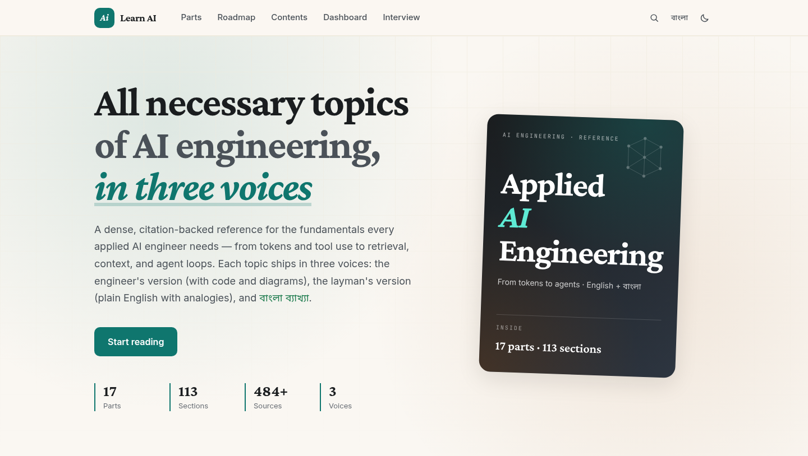

## Contents

- [At a glance](#at-a-glance)
- [Features](#features)
- [The 17 Parts](#the-17-parts)
- [Quick start](#quick-start)
- [How it works](#how-it-works)
- [Project structure](#project-structure)
- [Documentation](#documentation)
- [Contributing](#contributing)
- [Credits](#credits)
- [License](#license)

## At a glance

| What | Count |
| --- | --- |
| Parts | 17 |
| Sections | 113 |
| Cited sources | 484, from 95 sites (215 of them arXiv papers) |
| Voices in each section | 3: Technical, Layman's, বাংলা |
| Languages | English and Bangla, page for page |
| Quiz questions | 85: a 5-question quiz at the end of every Part |
| Practice tasks | 87, done in any free AI chat |
| YouTube clips | 408: 325 videos and 83 Shorts |
| Interview questions | 51: 3 for each Part |
| Study roadmap | 7 stages, 20 phases, 542 lessons, 8 learning paths |
| Accounts, analytics, back end | None. Progress stays in your browser. |

These counts come from the content files. The home page computes its own
counts at build time.

## Features

### Read one section at a time

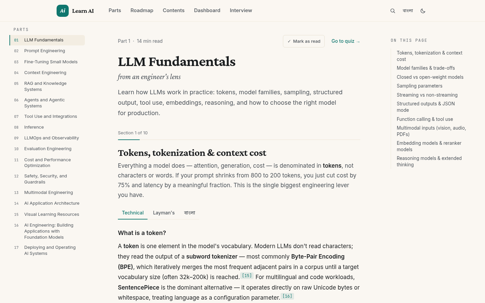

- A Part opens with its reading time, a **Mark as read** button, and a link
  to its quiz.
- A Part with several sections shows one section at a time, with a step bar
  and **Previous** / **Next** buttons. A link to any heading still works: it
  opens the step that holds the heading.
- The Parts list is on the left. **On this page** is on the right on wide
  screens and becomes a collapsed list on narrow ones.
- Each section ends with **Bookmark** and **Mark as done**. Each Part ends
  with its numbered sources and links to the previous and next Part.

### Three voices

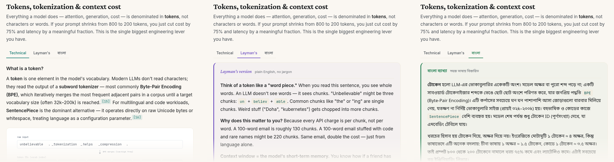

| Voice | What you get |
| --- | --- |
| Technical | Prose with diagrams, code, tables, and numbered citations. |
| Layman's | Plain English with analogies and no jargon. |
| বাংলা | A Bangla explanation that keeps the common English technical words (prompt, token, model). |

Pick a voice once. Every section follows your choice, and the browser
remembers it.

### Practice, videos, and a quiz

<table>
  <tr>
    <td width="33%" valign="top">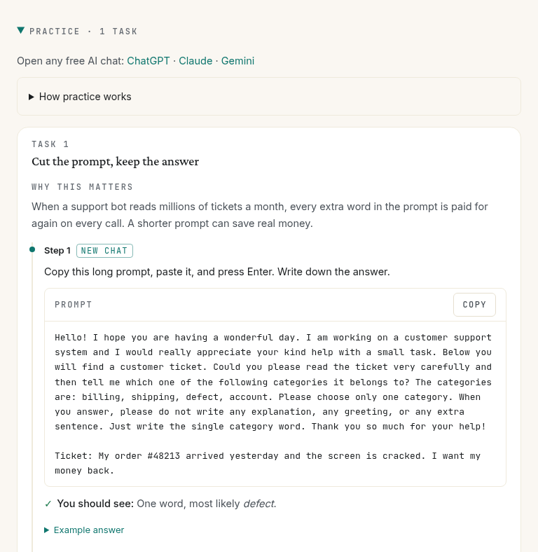</td>
    <td width="33%" valign="top">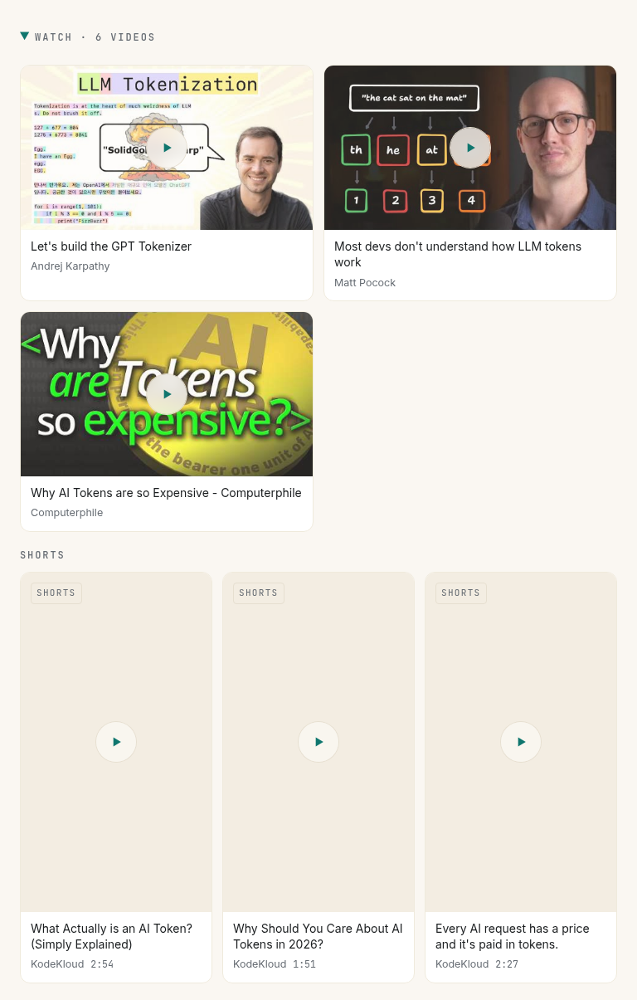</td>
    <td width="33%" valign="top">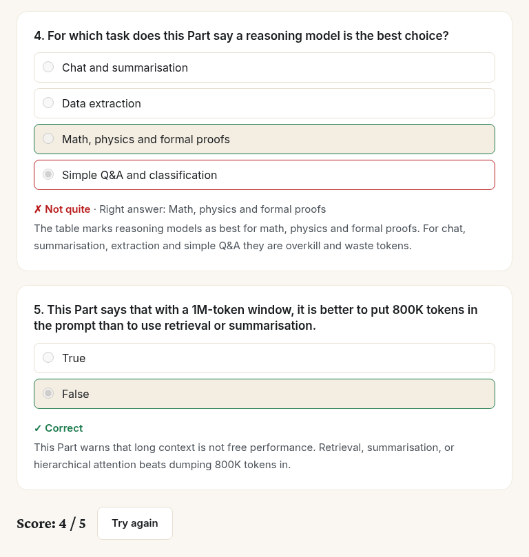</td>
  </tr>
  <tr>
    <td valign="top"><b>Practice.</b> Guided tasks for ChatGPT, Claude, or Gemini. No install and no API key. Each task has prompts to copy, what you should see, an example answer, a self-check, and a harder version.</td>
    <td valign="top"><b>Videos.</b> Hand-picked YouTube clips, with Shorts in their own row. Nothing loads from YouTube until you open the list, and a video plays in place through <code>youtube-nocookie.com</code>.</td>
    <td valign="top"><b>Quiz.</b> Five questions at the end of every Part. You see the right answer and why, and your best score is saved.</td>
  </tr>
</table>

### Search everything

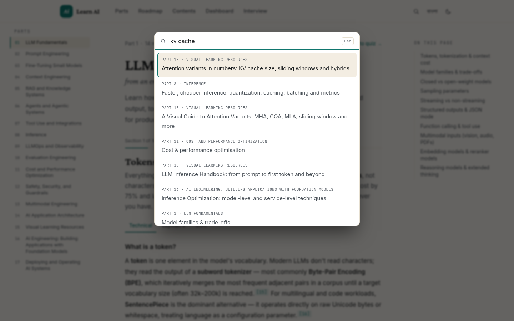

Press <kbd>Ctrl</kbd>+<kbd>K</kbd> (<kbd>⌘</kbd>+<kbd>K</kbd> on macOS)
on any page. The search runs in the browser over one entry per section. The
Bangla site has its own index, and it still finds English terms such as
"token".

### A study roadmap, with the lessons on the site

<table>
  <tr>
    <td width="50%" valign="top">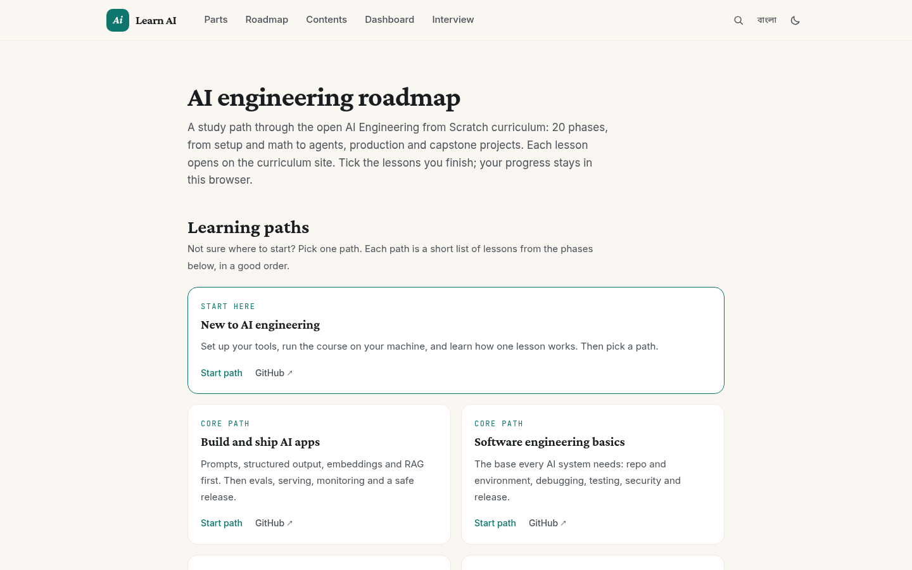</td>
    <td width="50%" valign="top">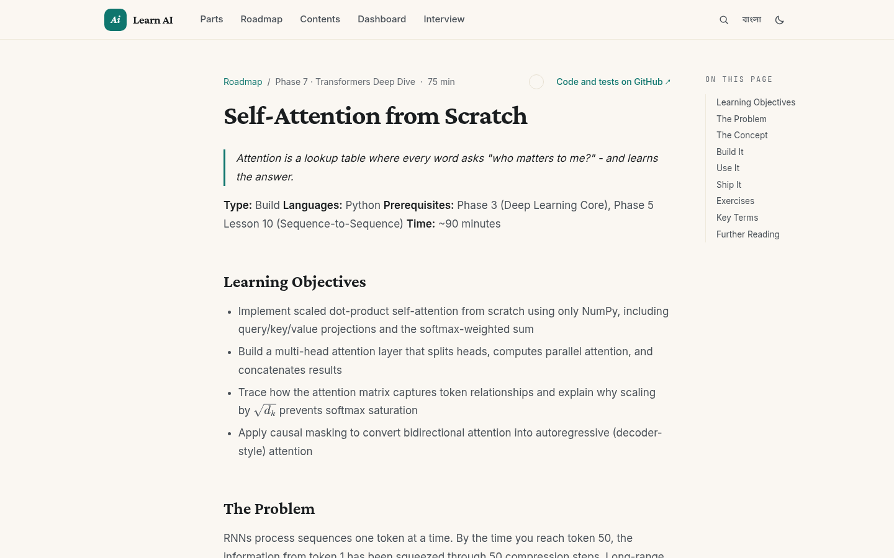</td>
  </tr>
</table>

The roadmap follows the open
[AI Engineering from Scratch](https://github.com/rohitg00/ai-engineering-from-scratch)
curriculum. It groups 20 phases into 7 stages, marks 5 phases as optional
depth, and links phases to the Parts that cover the same ground. Eight
learning paths give a starting order. Each of the 542 lessons is a page on
this site: math renders with KaTeX, and a long lesson gets an outline. Tick
lessons off to see how much time is left.

### Progress that stays in your browser

<table>
  <tr>
    <td width="50%" valign="top">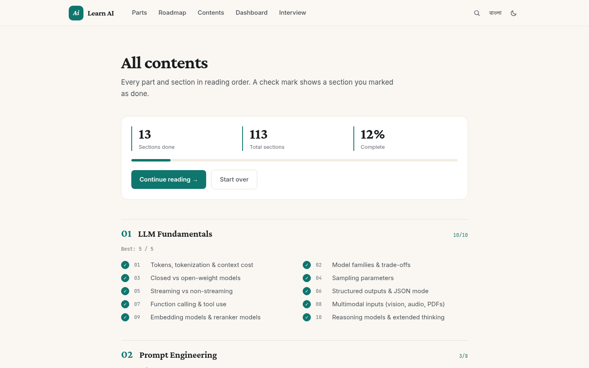</td>
    <td width="50%" valign="top">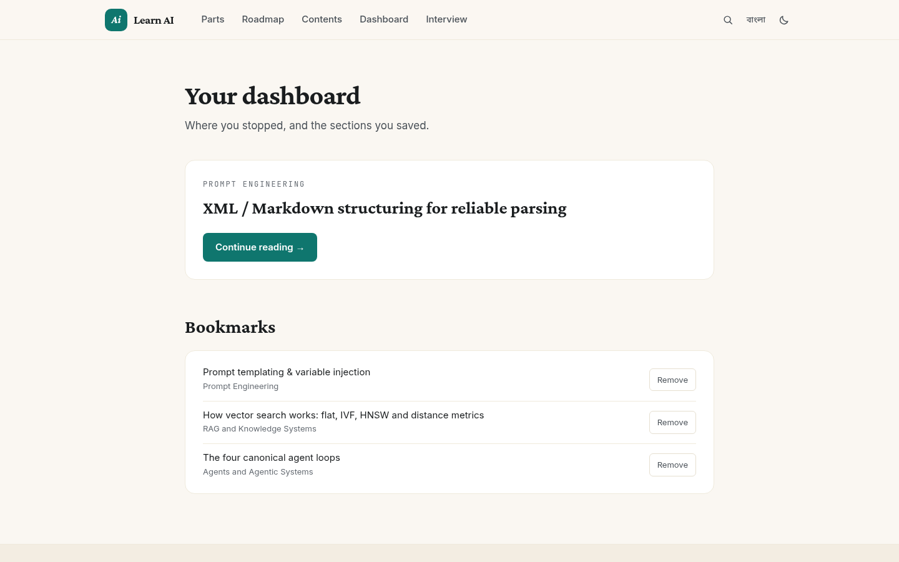</td>
  </tr>
</table>

**All contents** lists every section with a check mark, your overall
progress, and each Part's best quiz score. **Dashboard** shows where you
stopped and your bookmarks. There is no account. Everything is saved in
`localStorage`.

### Interview questions and open-source repos

<table>
  <tr>
    <td width="50%" valign="top">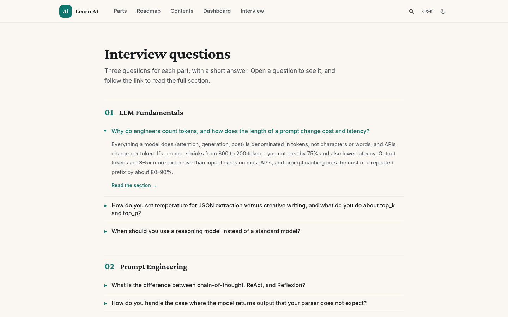</td>
    <td width="50%" valign="top">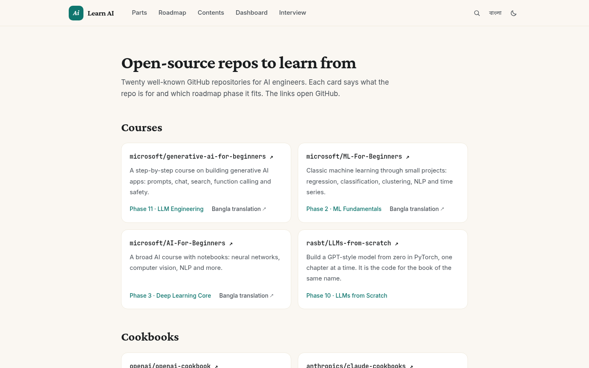</td>
  </tr>
</table>

**Interview** has three questions for each Part, each with a short answer and
a link to the section that explains it. **Resources** lists 20 well-known
GitHub repositories in 5 groups, each tied to a roadmap phase.

### English and বাংলা

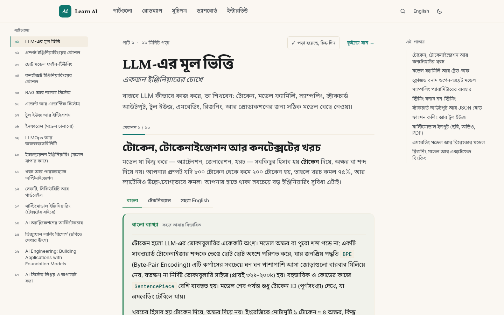

Every page has a twin under `/bn/`. On the Bangla site the interface, the
Part and section titles, the intros, the practice tasks, and the quizzes are
in Bangla, and sections open in the বাংলা voice unless you picked another.
The header button switches to the same page in the other language and
remembers the choice.

### Light and dark

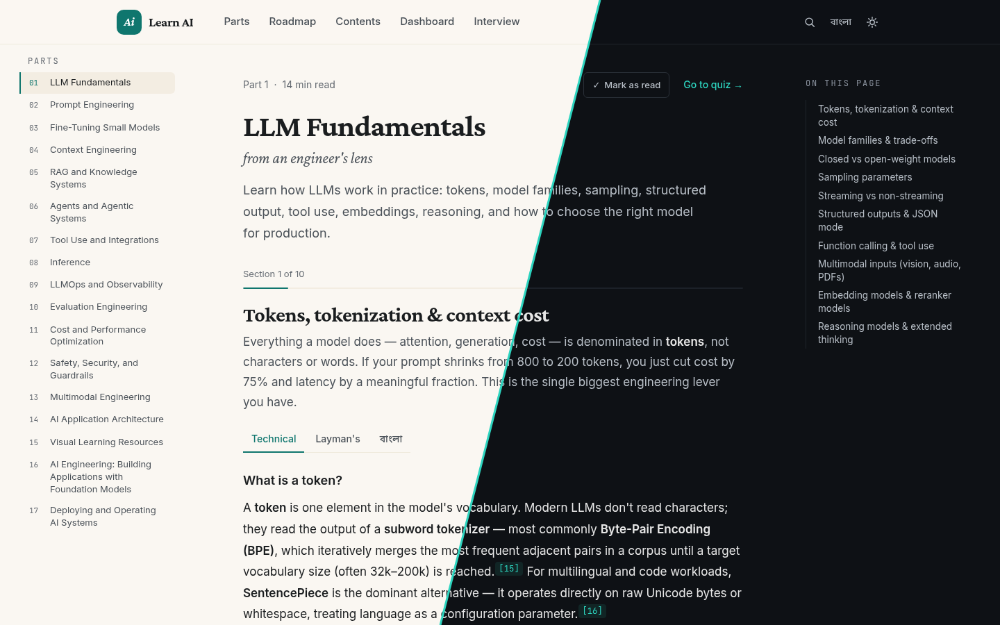

The site follows your device setting until you pick a theme with the
sun/moon button. A script in `<head>` applies the saved theme before the
first paint, so the page does not flash.

### Phones, install, and offline

<table>
  <tr>
    <td width="50%" align="center">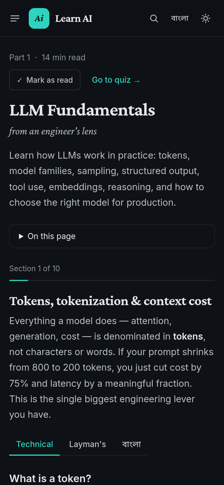</td>
    <td width="50%" align="center">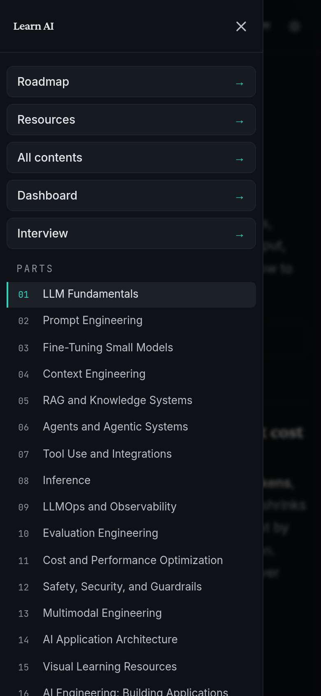</td>
  </tr>
</table>

On narrow screens a menu button opens the pages and the Parts. The site is an
installable web app: a service worker saves every page except the curriculum
lessons, so the Parts, the roadmap, and search work offline.

<details>
<summary><b>More screenshots</b>: roadmap progress, live views</summary>

<br>

<table>
  <tr>
    <td width="50%" valign="top">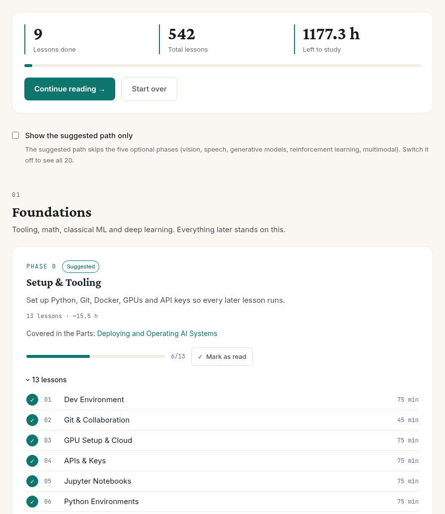</td>
    <td width="50%" valign="top">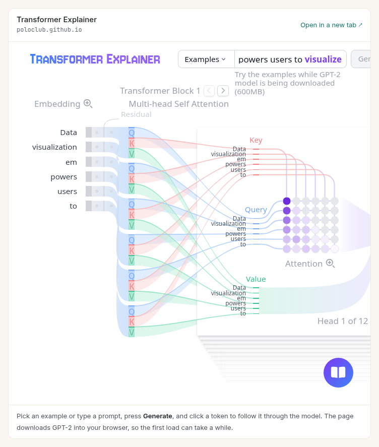</td>
  </tr>
  <tr>
    <td valign="top">The roadmap counts lessons done, total lessons, and time left. A filter hides the five optional phases.</td>
    <td valign="top">Part 15 embeds interactive explainers from other sites. Most frames load when you click them; a few light ones load as they scroll into view.</td>
  </tr>
</table>

</details>

## The 17 Parts

| # | Part | Sections | Sources | Clips |
| ---: | --- | ---: | ---: | ---: |
| 1 | [LLM Fundamentals](https://kawsar-95.github.io/ai-learning-roadmap/topics/llm-fundamentals/) | 10 | 26 | 56 |
| 2 | [Prompt Engineering](https://kawsar-95.github.io/ai-learning-roadmap/topics/prompt-engineering/) | 8 | 16 | 29 |
| 3 | [Fine-Tuning Small Models](https://kawsar-95.github.io/ai-learning-roadmap/topics/fine-tuning-roadmap/) | 6 | 22 | 16 |
| 4 | [Context Engineering](https://kawsar-95.github.io/ai-learning-roadmap/topics/context-engineering/) | 7 | 11 | 27 |
| 5 | [RAG and Knowledge Systems](https://kawsar-95.github.io/ai-learning-roadmap/topics/rag-knowledge-systems/) | 18 | 68 | 48 |
| 6 | [Agents and Agentic Systems](https://kawsar-95.github.io/ai-learning-roadmap/topics/agents-and-agentic-systems/) | 10 | 30 | 56 |
| 7 | [Tool Use and Integrations](https://kawsar-95.github.io/ai-learning-roadmap/topics/tool-use-and-integrations/) | 2 | 30 | 14 |
| 8 | [Inference](https://kawsar-95.github.io/ai-learning-roadmap/topics/inference/) | 3 | 30 | 13 |
| 9 | [LLMOps and Observability](https://kawsar-95.github.io/ai-learning-roadmap/topics/llmops-and-observability/) | 1 | 30 | 8 |
| 10 | [Evaluation Engineering](https://kawsar-95.github.io/ai-learning-roadmap/topics/evaluation-engineering/) | 1 | 30 | 13 |
| 11 | [Cost and Performance Optimization](https://kawsar-95.github.io/ai-learning-roadmap/topics/cost-and-performance-optimization/) | 1 | 30 | 13 |
| 12 | [Safety, Security, and Guardrails](https://kawsar-95.github.io/ai-learning-roadmap/topics/safety-security-and-guardrails/) | 1 | 30 | 13 |
| 13 | [Multimodal Engineering](https://kawsar-95.github.io/ai-learning-roadmap/topics/multimodal-engineering/) | 1 | 30 | 9 |
| 14 | [AI Application Architecture](https://kawsar-95.github.io/ai-learning-roadmap/topics/ai-application-architecture/) | 1 | 30 | 9 |
| 15 | [Visual Learning Resources](https://kawsar-95.github.io/ai-learning-roadmap/topics/visual-learning-resources/) | 11 | 32 | 38 |
| 16 | [AI Engineering: Building Applications with Foundation Models](https://kawsar-95.github.io/ai-learning-roadmap/topics/ai-engineering-book/) | 17 | 3 | 30 |
| 17 | [Deploying and Operating AI Systems](https://kawsar-95.github.io/ai-learning-roadmap/topics/deploying-and-operating-ai-systems/) | 15 | 36 | 52 |

"Clips" counts videos and Shorts. A clip can be listed in more than one
Part: Part 16 follows Chip Huyen's book *AI Engineering* chapter by chapter
and lists some clips of the earlier Parts again. Part 15 walks through
interactive explainers such as the Transformer Explainer and LLM
Visualization. Part 17 covers the platform skills behind an AI app, from
Linux and Git to Docker, Kubernetes, CI/CD, MLOps, and observability.

The order is set in one place: `TOPIC_ORDER` in
[`src/lib/topics.ts`](src/lib/topics.ts).

## Quick start

You need Node.js 22.18 or newer (the deploy workflow uses Node 24) and npm.

```bash
git clone https://github.com/kawsar-95/ai-learning-roadmap.git
cd ai-learning-roadmap
npm install
npm run dev        # http://localhost:3000
```

| Command | What it does |
| --- | --- |
| `npm run dev` | Starts the dev server at <http://localhost:3000>. The service worker is off in development. |
| `npm run build` | Validates all content, writes the static site to `out/`, then writes the offline file list into `out/sw.js`. |
| `npx serve@latest out` | Serves the static build at <http://localhost:3000>. |
| `npm test` | Runs the 158 tests in `tests/` with Node's built-in test runner. |
| `npm run lint` | Runs ESLint. |
| `npm run check:videos` | Asks YouTube whether every listed video still exists and can be embedded. It needs the network, so `npm test` and the deploy do not run it. |

`npm run start` does not work. The site is a static export, so `next start`
has no server build to serve.

## How it works

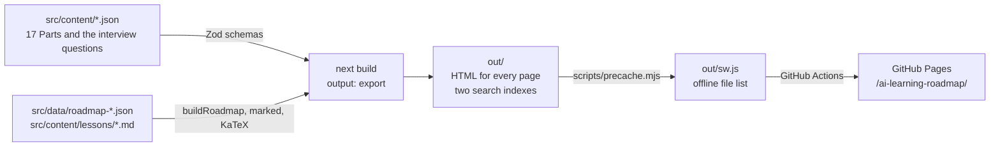

- **Content is data in the repo.** Each Part is one JSON file. Zod schemas
  check every file when the build loads it, so a bad file fails the build.
- **There is no server.** `next build` with `output: "export"` writes every
  page in both languages as HTML into `out/`.
- **Server-only modules read the data.** `src/lib/topics.ts` and
  `src/lib/roadmap.ts` load and validate the files. Client components get the
  data as props.
- **Reader state lives in the browser.** Progress, bookmarks, quiz scores,
  the voice, the theme, and the language are `localStorage` keys.
- **Search is static.** The build writes `search-index.json` (and the Bangla
  `bn/search-index.json`). The browser loads it on the first search and
  builds a [MiniSearch](https://github.com/lucaong/minisearch) index.
- **Offline is a build step.** `scripts/precache.mjs` writes the list of
  files to save, with a hash of each, into `out/sw.js`.
- **Deploys are automatic.** Every push to `main` runs the tests, builds with
  the GitHub Pages base path, and publishes `out/`.

The full picture is in [docs/architecture.md](docs/architecture.md).

**Stack:** Next.js 16 (App Router, static export) · React 19 · TypeScript 5 ·
Tailwind CSS 4 · Zod 4 · MiniSearch · marked and KaTeX (roadmap lessons) ·
Node's test runner.

## Project structure

```text
.
├── src/
│   ├── app/                  routes: (en)/ for English, bn/ for Bangla, the search
│   │                         indexes, the 404 page, the web app manifest, global CSS
│   ├── components/
│   │   ├── content/          sections, voices, practice, videos, live views, quiz
│   │   │   └── blocks/       one component per content block type
│   │   ├── layout/           header, footer, sidebar, phone menu, theme, language
│   │   ├── navigation/       search palette, "On this page"
│   │   ├── pages/            one component per page, shared by both languages
│   │   └── progress/         reading progress, bookmarks, roadmap ticks
│   ├── content/              the 17 Part files, interview.json, and lessons/
│   │                         (the copied curriculum lessons)
│   ├── data/                 the roadmap: lessons (generated) and phases (by hand)
│   └── lib/                  schemas, data loaders, i18n, search, progress, theme
├── tests/                    node:test suites for the libraries and the content
├── scripts/                  roadmap import, offline list, video check,
│                             video curation, screenshots
├── public/                   the service worker and the app icons
├── docs/                     guides, the quiz format, and the video records
├── screenshots/              the images in this README
└── .github/workflows/        the GitHub Pages deploy
```

A file-by-file map is in
[docs/architecture.md](docs/architecture.md#file-layout).

## Documentation

| Document | What it covers |
| --- | --- |
| [docs/architecture.md](docs/architecture.md) | Routes, the build, languages, voices, search, reader state, offline use, theme, design rules, tests, file layout |
| [docs/content-guide.md](docs/content-guide.md) | The Part file format, block types, code and diagrams, citations, videos, live views, practice tasks, interview questions, stable ids, adding a Part |
| [docs/quizzes.md](docs/quizzes.md) | The quiz format and its rules |
| [docs/roadmap.md](docs/roadmap.md) | The roadmap data, refreshing the curriculum lessons, learning paths, the resources page |
| [docs/deployment.md](docs/deployment.md) | GitHub Pages, the base path, setting up a fork, previewing a build, stalled deploys, troubleshooting |
| [docs/video-coverage.md](docs/video-coverage.md) | The channels the clips come from, and the topics Part 17 was added to cover |
| [docs/video-review-log.md](docs/video-review-log.md) | Every clip that was added, and every clip that was read and left out, with the reason |
| [scripts/video-curation/README.md](scripts/video-curation/README.md) | The scripts that found and verified the clips |
| [scripts/screenshots/README.md](scripts/screenshots/README.md) | Retaking the screenshots in this README |
| [docs/superpowers/](docs/superpowers/) | Design specs and plans of past redesigns (historical) |
| [CONTRIBUTING.md](CONTRIBUTING.md) | How to make a change, the checks to run, the code conventions, and the writing rules |

## Contributing

Fixes and new content are welcome. Read [CONTRIBUTING.md](CONTRIBUTING.md)
first. In short:

1. Edit the content in `src/content/` or the code in `src/`.
2. Run `npm test`, `npm run lint`, and `npm run build`. All three must pass.
3. If the change is visible, retake the screenshots
   ([scripts/screenshots/README.md](scripts/screenshots/README.md)).
4. Open a pull request. No workflow runs on pull requests, so paste the
   results of the three checks.

## Credits

- **Roadmap lessons:** [AI Engineering from Scratch](https://github.com/rohitg00/ai-engineering-from-scratch)
  by Rohit Ghumare and contributors, MIT license. The lessons are copied at a
  pinned commit into `src/content/lessons/`, with their license.
- **Videos** belong to their creators. The site embeds them through YouTube.
  [docs/video-coverage.md](docs/video-coverage.md) lists the channels.
- **Live views** in Part 15 are other people's interactive pages, for
  example Polo Club's Transformer Explainer and Brendan Bycroft's LLM
  Visualization. They load in a sandboxed frame.
- **Sources:** every Part lists the papers, documentation, and posts it
  cites.
- Built and maintained by [Nuruddin Kawsar](https://github.com/kawsar-95).

## License

[MIT](LICENSE). The copied curriculum lessons keep their own MIT license, in
[`src/content/lessons/LICENSE`](src/content/lessons/LICENSE).
